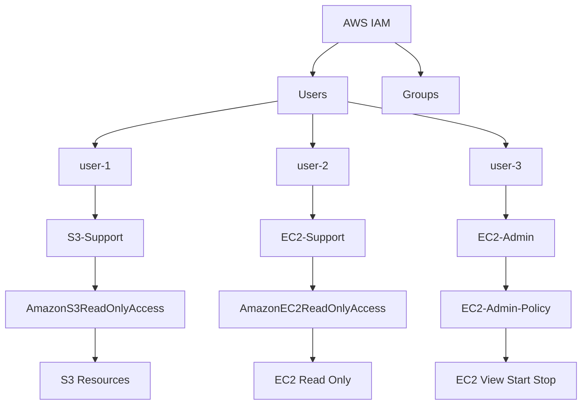

# 🔐 AWS Academy Association – IAM User & Group Management


## 📌 1. Project Overview

This project is part of **AWS Academy Association**.

In this hands-on lab, I explored **AWS Identity and Access Management (IAM)** and learned how to manage users, groups, and permissions securely.

The lab simulates a real-world company where employees receive different AWS permissions based on their job responsibilities.

🎯 **Main Goal:** Implement access control using IAM Users, Groups, and Policies while following the Principle of Least Privilege.

---

## 🎯 2. Learning Objectives

After completing this lab, I learned how to:

- 👤 Explore pre-created IAM Users.
- 👥 Understand IAM User Groups.
- 🔑 Inspect Managed and Inline Policies.
- 🛡️ Assign users to groups based on their job roles.
- 📄 Understand IAM Policies written in JSON.
- 🧪 Test permissions using different IAM users.
- 🔒 Apply the Principle of Least Privilege.

---

## 🧠 3. Understanding AWS IAM

### 🔹 What is IAM?

AWS Identity and Access Management (IAM) is a service that helps securely control access to AWS resources.

It determines:

- Who can access AWS?
- Which resources can they access?
- What actions are they allowed to perform?

### 👤 IAM Users

An IAM User represents an individual identity that can access AWS resources.

In this lab, three users were provided:

- `user-1`
- `user-2`
- `user-3`

### 👥 IAM Groups

An IAM Group is a collection of IAM Users.

Instead of assigning permissions individually, we can attach policies to groups and add users to those groups.

**Example:** When `user-1` joins `S3-Support`, the user inherits the permissions attached to that group.

### 🔑 IAM Policies

An IAM Policy is a JSON document that defines permissions.

A policy contains three important elements:

| Element | Description |
|---|---|
| Effect | Allow or Deny an action |
| Action | Specifies which AWS operations are allowed or denied |
| Resource | Specifies which AWS resources the policy applies to |

**Example IAM Policy:**

```json
{
  "Effect": "Allow",
  "Action": "ec2:Describe*",
  "Resource": "*"
}
```

📝 Explanation:

- `Effect`: Allows the specified actions.
- `Action`: Allows matching EC2 Describe operations.
- `Resource`: Applies to all resources within the policy scope.

### 📚 Managed Policy vs Inline Policy

**Managed Policy**
- A reusable policy.
- Can be attached to multiple Users and Groups.
- Examples: `AmazonEC2ReadOnlyAccess` and `AmazonS3ReadOnlyAccess`.

**Inline Policy**
- Attached directly to one specific User or Group.
- Used for specific permission requirements.
- Example: `EC2-Admin-Policy`.

---

## 🏢 4. Business Scenario

A company needs to assign AWS permissions to three employees based on their job responsibilities.

| IAM User | Group | Permissions |
|---|---|---|
| user-1 | S3-Support | S3 Read Only |
| user-2 | EC2-Support | EC2 Read Only |
| user-3 | EC2-Admin | View, Start, and Stop EC2 |

### 🏗️ IAM Architecture



---

## ⚙️ 5. Implementation Steps

### Step 1️⃣ – Explore IAM Users

Navigated to IAM → Users and inspected the three pre-created users.

Checked:
- Permissions
- Groups
- Security Credentials

Initially, the users were not members of any groups.

### Step 2️⃣ – Explore IAM Groups

Navigated to IAM → User Groups and inspected the following groups:

| Group | Attached Policy | Access Level |
|---|---|---|
| EC2-Support | AmazonEC2ReadOnlyAccess | Read Only |
| S3-Support | AmazonS3ReadOnlyAccess | Read Only |
| EC2-Admin | EC2-Admin-Policy | View, Start, Stop |

### Step 3️⃣ – Add Users to Groups

Assigned users to their corresponding groups:

1. Added `user-1` to `S3-Support`.
2. Added `user-2` to `EC2-Support`.
3. Added `user-3` to `EC2-Admin`.

Verified that each group contained one user.

### Step 4️⃣ – Get IAM Sign-in URL

Navigated to IAM Dashboard and copied the IAM User Sign-in URL.

Used a private browser window to test each user's permissions independently.

---

## 🧪 6. Permission Testing

### 👤 User 1 – S3 Support

**Credentials**
- Username: `user-1`

**Expected Permissions**
- View S3 buckets.
- Browse bucket contents.
- No EC2 access.

**Results**

| Test | Expected Result |
|---|---|
| View S3 Buckets | ✅ Allowed |
| Access EC2 Instances | ❌ Denied |

### 👤 User 2 – EC2 Support

**Credentials**
- Username: `user-2`

**Expected Permissions**
- View EC2 instances.
- Cannot modify or stop instances.
- No S3 access.

**Results**

| Test | Expected Result |
|---|---|
| View EC2 Instances | ✅ Allowed |
| Stop EC2 Instance | ❌ Denied |
| Access S3 | ❌ Denied |

### 👤 User 3 – EC2 Administrator

**Credentials**
- Username: `user-3`

**Expected Permissions**
- View EC2 instances.
- Start EC2 instances.
- Stop EC2 instances.

**Results**

| Test | Expected Result |
|---|---|
| View EC2 Instances | ✅ Allowed |
| Stop EC2 Instance | ✅ Allowed |

---

## 🔒 7. Principle of Least Privilege

The **Principle of Least Privilege** means giving each user only the permissions necessary to perform their job.

Examples from this lab:

- S3 Support only needs access to S3.
- EC2 Support only needs read-only EC2 access.
- EC2 Admin needs additional permissions to manage EC2 instances.

💡 This approach improves security and reduces the risk of unauthorized actions.

---

## 📸 8. Lab Screenshots

### 🖥️ IAM Dashboard


### 👤 IAM Users


### 👥 IAM Groups


### 🔑 IAM Policies


### 🪣 S3 Policy


### ⚙️ EC2 Admin Policy


### 🏆 Final Lab Result


---

## 📚 9. Key Takeaways

Through this hands-on lab, I learned:

1. IAM manages access to AWS resources.
2. Users represent individual identities.
3. Groups simplify permission management.
4. Policies define allowed and denied actions.
5. Users inherit permissions through group membership.
6. Read-only access allows viewing resources without modifying them.
7. Different job roles require different permission levels.
8. Least Privilege is an important AWS security principle.

---

## 🏁 10. Final Result

Successfully completed the **AWS Academy Association – IAM Lab**.

Implemented IAM user and group management, inspected policies, assigned role-based permissions, and tested access restrictions using three different IAM users.

### 🛠️ Services & Skills

- AWS IAM
- Amazon EC2
- Amazon S3
- Identity and Access Management
- IAM Policies (JSON)
- Role-Based Access Control (RBAC)
- Principle of Least Privilege
- Access Permission Testing

**Status:** ✅ Completed

---

⭐ This project is part of my journey toward becoming an AWS Cloud Engineer.
